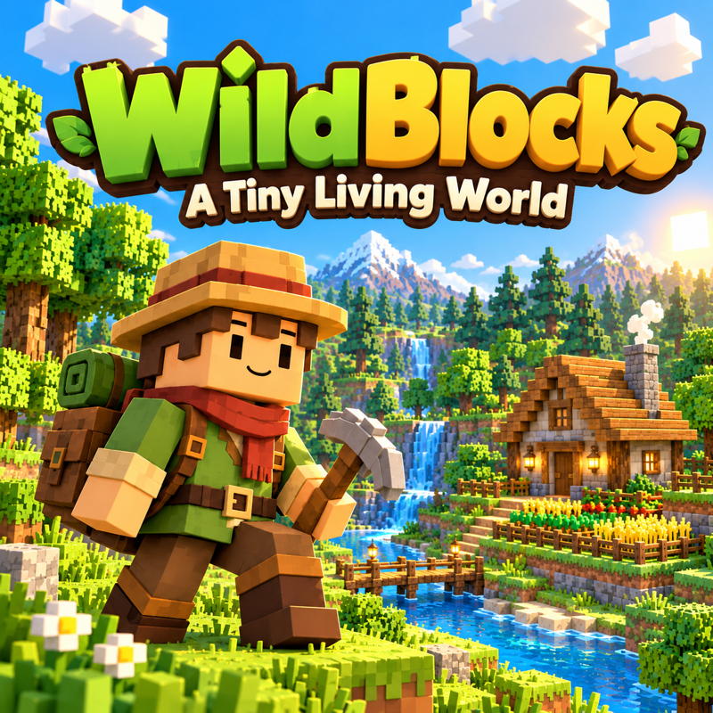
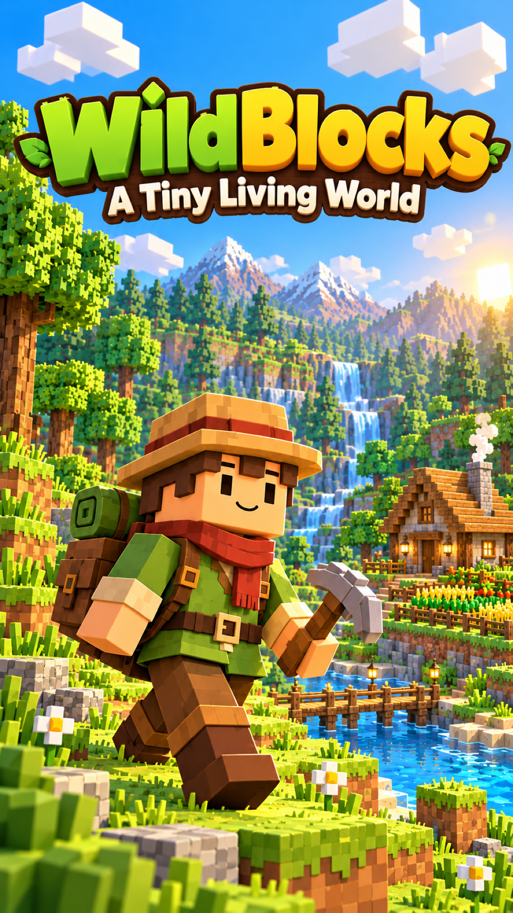
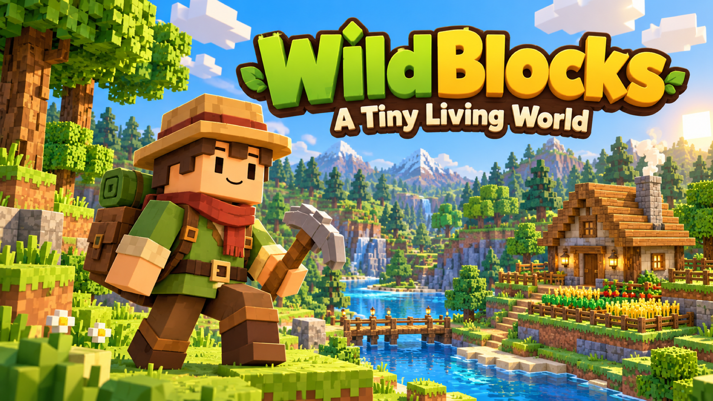

# WildBlocks — Playgama upload content

Copy the text below into the matching fields in the Playgama publishing form. Upload the three PNG covers separately from the game ZIP.

## Game title

WildBlocks — A Tiny Living World

## Short description

Explore a cozy voxel world, gather and craft, befriend wildlife, and build your dream home alone or with friends.

## Game description

Make a tiny living world your own in WildBlocks, a cozy voxel adventure about exploring, crafting, and building a place to call home.

Wander through meadows, forests, rivers, caves, and ancient ruins. Chop trees, collect resources, craft tools, grow crops, cook food, and meet the creatures that share your world. Build a shelter, furnish your home, and improve your Homestead as you discover new places and complete quests. Choose Peaceful difficulty for a gentler adventure, or face the challenges of the wilds.

Want to focus on creating? Build Home gives you unlimited building materials and dedicated tools for walls, rooms, roofs, furniture, gardens, and more. Walk through your creations, save blueprints, and keep shaping your dream home.

Explore on your own, invite friends to build together, or try multiplayer battles. Save your worlds and return to continue your adventure. Your next discovery is just a few blocks away!

## How to play

Choose **New World** to start an adventure, or **Build Home** to create with unlimited materials. In Survival, follow the starting quests, gather wood and other resources, then open the Backpack and Recipe Book to craft tools and useful items. Build a shelter, plant crops, prepare food, and explore to improve your Homestead. Aim at objects to use them, and keep your favorite tools in the hotbar.

**Desktop:** Move with WASD and look around with the mouse. Press Space to jump, Shift to sprint, and Ctrl or C to crouch. Hold the left mouse button to chop, mine, or attack. Use the right mouse button to place blocks or use the item you are holding. Press F to interact, E for the Backpack and Recipe Book, J for the Journal, M for the map, and Esc for the pause menu. Select hotbar items with 1–9 or the mouse wheel. Click the game view to capture the mouse when prompted.

**Phone or tablet:** Turn your device to landscape. Move with the left joystick and drag the right side of the screen to look around. Tap the screen to use the selected item, and press and hold to break blocks. Use the onscreen buttons for jumping, placing, interacting, and opening the Backpack. Tap hotbar slots to select items. The in-game How to Play guide explains the touch controls and each mode.

**Build Home:** Open the catalog with B, choose a material or object, and use the building tools to place and shape your home. R rotates, X selects the remove tool, and Ctrl+Z / Ctrl+Y undo and redo. On touch devices, use the tool drawer and onscreen actions. Open How to Play for the complete building guide.

If you are defeated, choose a **Respawn** button when you are ready; the game does not respawn you automatically. Deathmatch requires a five-second cooldown before its Respawn button becomes available.

Use **Save & Quit to Menu** when you finish a session. Choose **Continue** or select a saved world to return. Multiplayer requires an internet connection; create or join a room and share its code with friends.

### Desktop controls reference

| Action | Default control |
| --- | --- |
| Move / look | WASD / mouse |
| Jump / sprint / crouch | Space / Shift / Ctrl or C |
| Chop, mine, break, or attack | Hold left mouse button |
| Place a block or use held item | Right mouse button |
| Interact with objects and creatures | F |
| Backpack and Recipe Book | E |
| Select hotbar item | 1–9 or mouse wheel |
| Journal / map | J / M |
| First / third-person view | V |
| Free cursor / return to mouse-look | Backtick |
| Pause menu | Esc |

These are the default bindings. Players can change supported bindings in Settings → Controls. Build Home and Deathmatch also have mode-specific controls in the in-game guide.

## Other publishing fields

| Field | Suggested value |
| --- | --- |
| Engine / technology | Three.js; HTML5 browser game built with React, TypeScript, and Vite |
| Version | 1.3.0 |
| Language | English |
| Gameplay orientation | Landscape |
| Categories | Adventure, Sandbox, Simulation — choose the closest available categories |
| Tags | Voxel, Building, Crafting, Exploration, Farming, Creative, Multiplayer |
| Features | Survival, creative building, saved worlds, blueprints, quests, multiplayer |
| Players | Single-player; optional multiplayer rooms for up to 8 players |
| Distribution | Playgama |
| Devices | Desktop; phone/tablet only after the relevant physical-device checks pass |

Select the matching options offered by the live form. The portrait cover is promotional artwork; gameplay still uses landscape orientation.

## Cover images to upload

The dimensions below match the publishing-form screenshot you supplied.

| Upload field | Ratio | Exact size | PNG file |
| --- | --- | --- | --- |
| Square | 1:1 | 800 × 800 pixels | [wildblocks-square-800x800.png](covers/wildblocks-square-800x800.png) |
| Portrait | 9:16 | 1080 × 1920 pixels | [wildblocks-portrait-1080x1920.png](covers/wildblocks-portrait-1080x1920.png) |
| Landscape | 16:9 | 1920 × 1080 pixels | [wildblocks-landscape-1920x1080.png](covers/wildblocks-landscape-1920x1080.png) |

These covers are illustrated promotional artwork based on the game's original voxel explorer and world. Use actual gameplay captures if the form separately requests screenshots. The image-generation prompts are recorded in [COVER-PROMPTS.md](COVER-PROMPTS.md).

### Cover previews

Square:

Portrait:

Landscape:

## Game file and final upload steps

1. Run `npm run release` when you change the game. `npm run realese` runs the same pipeline.
2. Upload [wildblocks-1.3.0-playgama.zip](../release/wildblocks-1.3.0-playgama.zip) in the game-build field.
3. Paste the title, description, and how-to-play text above into the matching publishing fields.
4. Upload each PNG to its matching Square, Portrait, or Landscape cover field.
5. Run Playgama's **Test Game**. Check Game Ready, ads, pause/audio behavior, and saved progress across a new session.
6. Finish the [manual submission checklist](../docs/PLAYGAMA-SUBMISSION.md), review the cover previews and content, then submit the game.

The covers and this document live outside `dist/`, so they are uploaded separately and do not increase the game ZIP size.
